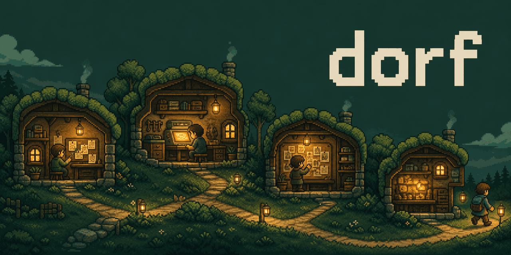

<picture>
  <source media="(prefers-reduced-motion: reduce)" srcset="assets/cover.png">
  
</picture>

<p align="center"><strong>Hand a coding task to an agent that works in its own Linux machine.</strong></p>

# Dorf

Dorf is a self-hosted coding agent. Each Thread gets its own Sandbox: an isolated Linux machine
that keeps its files and running processes while paused and resumes on the next tool call. The
agent loop runs outside the Sandbox, built on [Pi Durable](https://github.com/earendil-works/pi);
Sandboxes run on [Agent Substrate](https://github.com/agent-substrate/substrate).

```text
 you -> agent (Threads, Pi Durable) --tools--> Sandbox per Thread (Agent Substrate)
```

**Status:** rebuild in progress. The [North Star](docs/north-star.md) describes the
product and [Slices](docs/slices.md) tracks the work. Releases up to 0.31.3 were a different
product, a control plane for third-party agent harnesses; that code is frozen at the `v0.31.3` tag.

Contributions are submitted under the [Apache 2.0 license](LICENSE). Contributors retain copyright
in their contributions and must have the right to submit them.
